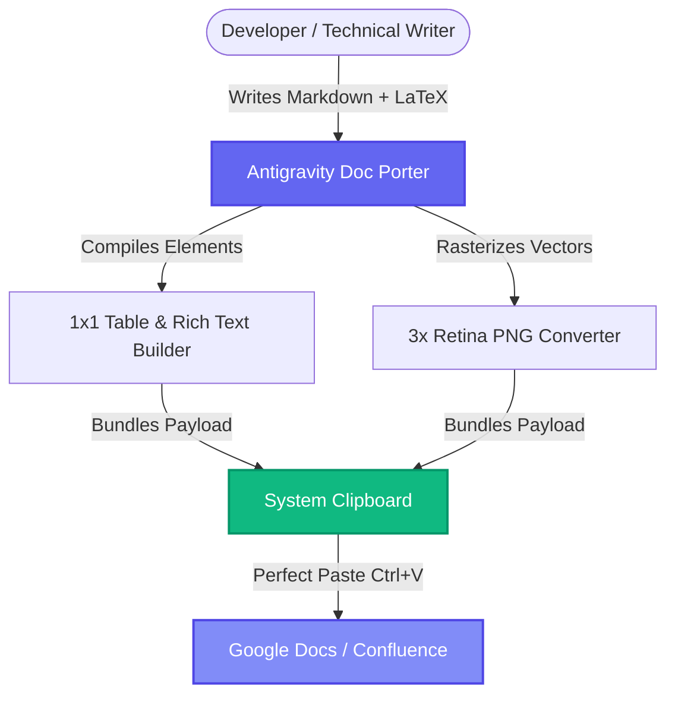

# Antigravity Doc Porter 📄✨

> **Frictionless Markdown, Mermaid Diagrams & LaTeX Math Formulas to Google Docs, Confluence, and PDF.**

[](https://nodejs.org/)
[](LICENSE)
[](Dockerfile)
[](#architecture)

---

## 🎯 The Problem

Developers, researchers, and technical writers love composing documentation in **Markdown**, **Mermaid.js**, and **LaTeX**. However, pasting raw Markdown or rich diagrams into rich-text enterprise suites like **Google Docs** and **Atlassian Confluence** is notoriously painful:

- ❌ **LaTeX Math formulas** don't paste into Google Docs without third-party add-ons, or they copy as broken, duplicated plaintext characters.
- ❌ **Mermaid diagrams** (`graph TD`, sequence diagrams, etc.) cannot be pasted into documents as editable rich media or vector graphics.
- ❌ **Inline code spans** (e.g. `` `access_token` ``) drop adjacent whitespace in Google Docs when switching fonts, mangling sentence readability.
- ❌ **Tables** paste with excessive default padding, massive before/after paragraph gaps, and broken column width distributions.
- ❌ **GitHub-style callout alerts** (`[!NOTE]`, `[!WARNING]`, `[!TIP]`) lose their borders, colors, and styling when copied.
- ❌ **Code blocks** paste as raw unbordered lines without syntax highlighting or background shading.

**Antigravity Doc Porter** is a browser-based conversion utility that compiles Markdown, vector Mermaid diagrams, and LaTeX formulas into an **enterprise-optimized HTML clipboard payload**. With a single click, you can paste pixel-perfect documents directly into Google Docs or Confluence with zero formatting loss.

---

## ⚡ Key Capabilities

### 1. 📐 High-Fidelity LaTeX Math & Formulas
- Supports **Display Math Blocks** (`$$ ... $$`, `\[ ... \]`, or ```` ```math ```` code blocks).
- Supports **Inline Math** (`$ ... $` or `\( ... \)`).
- Renders mathematically rigorous, razor-sharp vector SVG formulas in the live preview using MathJax.
- **Google Docs Image Rasterizer**: Automatically transforms formulas into crystal-clear **3x Retina PNG images** during clipboard copy, perfectly centered (block math) or baseline-aligned (inline math).
- **Per-Equation Toolbar**: Hover over any formula in the preview to:
  - 📋 **Copy PNG**: Copy just that formula as a 3x Retina PNG.
  - 💾 **Download PNG**: Save the formula as an image file.
  - 📝 **Copy TeX**: Copy the raw LaTeX source code to clipboard.

### 2. 📊 Mermaid Diagrams to 3x Retina PNG
- Live rendering of all Mermaid diagram types (flowcharts, sequence diagrams, ER diagrams, class diagrams, state machines, Gantt charts).
- Diagram toolbar on hover with single-click PNG copy or download.
- Automatically rasterizes SVGs to high-resolution PNG data URLs upon clipboard export so Google Docs renders diagrams without external image hosting dependencies.

### 3. 🛡️ Google Docs Compatibility Engine
- **Inline Code Spacing Fix**: Employs boundary whitespace locking with non-breaking spaces (`\u00A0`) and styled spans so Google Docs never drops spaces around inline code.
- **Compact Zero-Gap Tables**: Wraps table cell text in `0pt` Before/After paragraph wrappers and injects `<colgroup>` pixel and percentage widths based on real preview dimensions.
- **1x1 Table Callout Boxes**: Converts GitHub-style callout blocks (`[!NOTE]`, `[!TIP]`, `[!IMPORTANT]`, `[!WARNING]`, `[!CAUTION]`) into native 1x1 table boxes with matching theme borders, colored backgrounds, and Unicode emoji icons.
- **Bordered Code Blocks**: Wraps code blocks into shaded 1x1 table containers with preserved indentation, non-breaking spacing, and GitHub-style syntax highlighting colors.
- **Task Lists**: Automatically converts `<input type="checkbox">` elements into clean Unicode checkbox symbols (`☑️` / `☐`).

### 4. 🖨️ Crisp PDF & Print Export
- Dedicated `@media print` stylesheet optimized for standard A4 portrait pages.
- 20mm uniform page margins and intelligent page-break rules (`page-break-inside: avoid` on diagrams, formulas, tables, and callouts).
- Hides UI headers, toolbars, and editor panels automatically during print or PDF download.

### 5. 💻 Premium Workspace Experience
- Split-pane layout with live debounced document preview.
- **Dark & Light Mode** with persistent theme preferences.
- **Autosave & Local Storage**: Automatically caches document drafts in the browser.
- **File Management**: Open local `.md` / `.txt` files, download updated `.md` files, or drag-and-drop Markdown files directly onto the editor.
- **Live Statistics**: Real-time word count, diagram count, and math formula count in the pane header.

---

## 🚀 Quick Start

### Option 1: Run with Node.js
```bash
# Clone the repository
git clone https://github.com/milindpathak15/doc-porter.git
cd doc-porter

# Start the local development server (serves on port 3000)
npm start
```
The application will launch automatically at `http://localhost:3000`.

### Option 2: Run with Python
```bash
python3 -m http.server 3000
```
Then visit `http://localhost:3000` in your browser.

### Option 3: Run with Docker
```bash
# Build the container image
docker build -t doc-porter .

# Run the container
docker run -d -p 3000:3000 --name doc-porter doc-porter
```
Access the application at `http://localhost:3000`.

---

## 📝 Supported Syntax & Examples

### 1. LaTeX Equations

#### Display Math Block:
```markdown
### Formula Structure:

$$
\text{Component Score } S_i \in [0, 100] = \min\left(100, \; \sum (\text{Mapped Metric} \times \text{Weight})\right)
$$
```

#### Inline Math:
```markdown
The final calculated score $S_i \in [0, 100]$ is mapped using normalized weights where $E = mc^2$.
```

#### Fenced Code Block Math:
````markdown
```math
\sigma = \sqrt{\frac{1}{N} \sum_{i=1}^{N} (x_i - \mu)^2}
```
````

---

### 2. Mermaid Diagrams
````markdown

````

---

### 3. GitHub-Style Callout Alerts
```markdown
> [!NOTE]
> Standard information callout box with blue border and background.

> [!TIP]
> Helpful recommendations and performance optimizations.

> [!IMPORTANT]
> Crucial instructions and essential guidelines.

> [!WARNING]
> Warnings regarding breaking changes or deprecated tokens.

> [!CAUTION]
> Critical actions that could result in unexpected behavior.
```

---

### 4. Tables with Proportional Column Layouts
```markdown
| Table Name | Field | Type | Description | Key |
| :--- | :--- | :--- | :--- | :--- |
| **UserSession** | `session_id` | VARCHAR(64) | Unique tracking token | PRIMARY KEY |
| | `payload_size` | INT | Buffer size in bytes | |
| **FormulaCache** | `formula_id` | VARCHAR(64) | SHA-256 hash of LaTeX block | PRIMARY KEY |
| | `image_blob` | BLOB | Compiled 3x PNG stream | |
```

---

### 5. YAML Frontmatter
```markdown
---
Title: Architecture & Technical Design Document
Author: Platform Engineering
Status: Approved
Version: 2.0
---
```

---

## 🏗️ Architecture & Pipeline

```
  ┌────────────────────────────────────────────────────────┐
  │                 Markdown Source Text                   │
  │     (Headings, Tables, Lists, Mermaid, LaTeX, etc.)    │
  └───────────────────────────┬────────────────────────────┘
                              │
             ┌────────────────┴────────────────┐
             ▼                                 ▼
   [marked.js Tokenizer]             [MathJax & Mermaid]
   - Parses AST blocks               - Generates self-contained
   - Isolates code blocks              vector SVG definitions
   - Preserves raw LaTeX math        - Local fontCache / Defs
             │                                 │
             └────────────────┬────────────────┘
                              ▼
  ┌────────────────────────────────────────────────────────┐
  │             Live Document Preview (DOM)                │
  │     - Interactive toolbars for diagrams & equations    │
  │     - Syntax-highlighted code blocks via Highlight.js  │
  └───────────────────────────┬────────────────────────────┘
                              │  User clicks "Copy for Google Doc"
                              ▼
  ┌────────────────────────────────────────────────────────┐
  │           Offline Transformer Pipeline                 │
  │  1. Clone preview DOM offline                          │
  │  2. Convert SVGs (Mermaid & LaTeX) to 3x Retina PNGs   │
  │  3. Transform callouts & code blocks into 1x1 tables   │
  │  4. Normalize cell margins: 0pt Before / 0pt After     │
  │  5. Lock inline code & math boundary spaces (\u00A0)   │
  │  6. Bundle clean HTML + Plaintext into ClipboardItem   │
  └───────────────────────────┬────────────────────────────┘
                              ▼
  ┌────────────────────────────────────────────────────────┐
  │             System Clipboard (Ctrl+V / ⌘+V)            │
  │     ──► Google Docs  ──► Confluence  ──► MS Word       │
  └────────────────────────────────────────────────────────┘
```

---

## 🧰 Tech Stack

- **Core Engine**: Vanilla JavaScript (ES6+), HTML5, CSS3 (Modern Flexbox/Grid).
- **Markdown Parsing**: [marked.js](https://marked.js.org/) with custom block & inline tokenizers.
- **LaTeX Math Engine**: [MathJax 3](https://www.mathjax.org/) (TeX-to-SVG with local glyph cache).
- **Diagram Engine**: [Mermaid.js](https://mermaid.js.org/) (crisp default light theme).
- **Syntax Highlighting**: [Highlight.js](https://highlightjs.org/) (GitHub dark theme on-screen, light in export).
- **Typography**: Google Fonts (*Outfit*, *Plus Jakarta Sans*, *JetBrains Mono*).
- **Icons**: Font Awesome 6.4.

---

## 📄 License

This project is licensed under the [MIT License](LICENSE).
